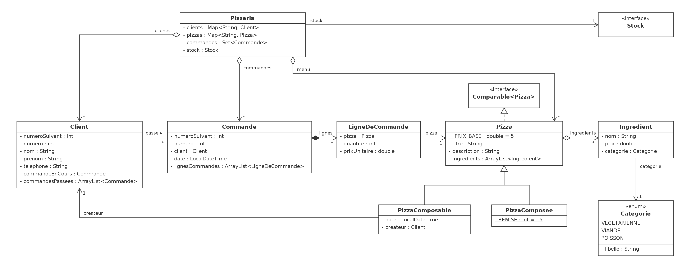

# Atelier 8 : Lecture de fichiers et compléments Java – séance 1

## Objectif

L'objectif de cet atelier est de savoir lire et écrire des fichiers texte en Java, de comprendre la différence entre exceptions vérifiées et non vérifiées appliquée aux entrées/sorties, et d'utiliser le bloc `try-with-resources` pour garantir la fermeture des ressources. Le tout sur la pizzeria de l'atelier 1, qui charge ses commandes depuis des fichiers.

## Concepts

1. Lecture de fichiers texte (`FileReader`, `BufferedReader`)
2. Écriture de fichiers texte (`FileWriter`, `BufferedWriter`)
3. `try-with-resources`
4. `AutoCloseable`
5. Exceptions vérifiées (`IOException`, `FileNotFoundException`)
6. Gestion d'erreurs de validation dans des données lues
7. Statistiques avec l'API Stream (`groupingBy`, `flatMap`)
8. Injection de dépendance (les tests fournis utilisent Mockito, atelier 5)

## Vidéos

### Fichiers et exceptions

1. [Apprendre Java #15 Fichier (File / Reader / Writer / Buffer)](https://www.youtube.com/watch?v=iCobhKfvf3M)
2. [Java File Input/Output - It's Way Easier Than You Think](https://www.youtube.com/watch?v=ScUJx4aWRi0)
3. [Exception Handling in Java Tutorial](https://www.youtube.com/watch?v=1XAfapkBQjk)
4. [Checked vs. Unchecked Exceptions in Java Tutorial - What's The Difference?](https://www.youtube.com/watch?v=bCPClyGsVhc)

### Autres concepts de la semaine

1. [Inner Class Java Tutorial - Creating and Using Inner Classes](https://www.youtube.com/watch?v=BwkmIXjWWJc)
2. [Java Anonymous Inner Classes Explained in 6 Minutes](https://www.youtube.com/watch?v=DwtPWZn6T1A)
3. [Learn VARARGS in 6 minutes!](https://www.youtube.com/watch?v=2knxgAFqwKk)

## Exercices

### Introduction

Cette séance part de la pizzeria de l'atelier 1, séance 2, mais son domaine a été complété : le diagramme ci-dessous n'est donc plus celui de l'atelier 1. Les ajouts vous sont fournis tout faits :

- la classe [`Pizzeria`](src/main/java/domaine/Pizzeria.java) (package `domaine`) rassemble les clients, retrouvés par leur numéro de téléphone, les pizzas du menu, retrouvées par leur titre, et les commandes reçues ;
- chaque `Ingredient` porte une catégorie, l'énuméré [`Categorie`](src/main/java/domaine/Categorie.java) (`VEGETARIENNE`, `VIANDE`, `POISSON`), d'où se déduit celle d'une pizza (`Pizza.getCategorie`) ;
- une `Commande` peut être créée à une date donnée, et les compteurs de numéros de `Client` et de `Commande` peuvent être remis à zéro pour les tests ;
- les lignes d'une commande, les ingrédients d'une pizza et l'historique d'un client sont accessibles en lecture seule (`getLignes`, `getIngredients`, `getCommandesPassees`) ;
- `Pizza` implémente `Comparable<Pizza>` (l'ordre des titres), et `Pizzeria.menuTrieParPrix` trie le menu par prix ;
- la `Pizzeria` reçoit à sa construction un [`Stock`](src/main/java/domaine/Stock.java), une interface qui dit s'il reste d'un ingrédient.

La classe [`DonneesPizzeria`](src/main/java/main/DonneesPizzeria.java) (package `main`) crée une pizzeria de vingt clients et huit pizzas.



La pizzeria enregistre chaque jour ses commandes dans un fichier (`2026-11-09.csv`, `2026-11-10.csv`, …), déposé dans un dossier `commandes/`. Chaque ligne décrit une commande d'une pizza : la date et l'heure, le téléphone du client, le titre de la pizza et la quantité, séparés par des points-virgules (`;`) :

```
2026-11-09T12:15:00;0488/98.23.85;margarita;2
```

Le dossier contient aussi un fichier d'index, `commandes/index.txt`, qui liste les noms des fichiers à traiter, un par ligne. Les données ne sont pas parfaitement propres : certaines lignes sont incomplètes ou citent un client ou une pizza inconnus, et l'index peut mentionner un fichier qui n'existe pas (une journée dont les commandes n'ont pas encore été déposées).

On souhaite écrire un programme qui charge toutes les commandes dans la pizzeria, calcule quelques statistiques (chiffre d'affaires par jour, pizzas vendues par catégorie) et écrit un rapport dans un nouveau fichier.

### Consignes

Dans IntelliJ, créez un projet Maven intitulé `AJ_atelier08_seance1` (voir le [tutoriel Maven](../../../05-mocks/02-seance2/AJ_atelier05_seance2/05B_3_tutoriel-maven.md) si besoin). Récupérez les classes fournies dans `AJ_atelier08_seance1/src/main/java/` (packages `domaine`, `util`, `main`) et les tests fournis dans `AJ_atelier08_seance1/src/test/java/` en conservant l'arborescence. Ajoutez les dépendances JUnit 5 et Mockito à votre `pom.xml` (voir le `pom.xml` fourni). Copiez également le dossier `commandes/` à la racine de votre projet (pas dans un package ni dans `src/`).

Chaque question est vérifiée par les tests JUnit fournis : exécutez-les directement dans IntelliJ (bouton ▶) pour vérifier votre implémentation au fur et à mesure. Les tests `PizzaTest` et `PizzeriaTest` portent sur le domaine fourni : ils sont verts dès le départ. Les questions 5 à 8 ont en plus chacune un test qui travaille sur les vrais fichiers du dossier `commandes/` (son nom finit par `SurLesVraisFichiers`) : il vérifie les valeurs que la classe [`Main`](src/main/java/main/Main.java) (package `main`) fournie affichera.

### Lire le fichier d'index

**Question 1** :

✏️ *A corriger au tableau*

Ouvrez la classe [`LecteurFichiers`](src/main/java/util/LecteurFichiers.java) (package `util`). Elle implémente l'interface [`LecteurCommandes`](src/main/java/util/LecteurCommandes.java) (fournie). Complétez la méthode `lireIndex(String chemin)` : ouvrez le fichier avec un `BufferedReader` dans un bloc `try-with-resources`, lisez-le ligne par ligne avec `readLine`, et renvoyez la liste des noms de fichiers lus, dans l'ordre du fichier. Ne traitez pas l'`IOException` ici : la signature de la méthode la propage avec `throws`.

### Lire un fichier de commandes

**Question 2** :
Complétez la méthode `lireLignes(String chemin)` de `LecteurFichiers` : ouvrez le fichier dans un bloc `try-with-resources`, mais récupérez cette fois toutes les lignes via la méthode `lines` du `BufferedReader`, qui renvoie un `Stream<String>` (à collecter dans une liste).

### Construire une commande

**Question 3** :
Ouvrez la classe [`AnalyseCommandes`](src/main/java/main/AnalyseCommandes.java) (package `main`). Elle reçoit la `Pizzeria` et un `LecteurCommandes` dans son constructeur. Complétez la méthode `parserLigne(String ligne)`, qui convertit une ligne en commande clôturée. Découpez la ligne avec `split(";")` et levez une `IllegalArgumentException` si elle ne compte pas exactement quatre champs, si la date est mal formée (`LocalDateTime.parse` lève alors une `DateTimeParseException`, qui n'est pas une `IllegalArgumentException` : attrapez-la), si le client ou la pizza est inconnu de la pizzeria, ou si la quantité n'est pas un entier strictement positif. Créez ensuite la commande à la date lue, ajoutez-y la pizza dans la quantité lue, et clôturez la commande en cours du client. Vérifiez bien tous les champs **avant** de créer la commande : la Javadoc de `parserLigne` explique pourquoi.

### Ignorer les lignes invalides

**Question 4** :
Complétez la méthode `parserLignes(List<String> lignes)` : pour chaque ligne, appelez `parserLigne`. Une ligne invalide ne doit pas interrompre le traitement : attrapez l'`IllegalArgumentException`, affichez `"Ligne ignorée : " + ligne` sur la sortie standard, et continuez avec la ligne suivante.

### Charger tous les fichiers

**Question 5** :
Complétez la méthode `chargerToutesLesCommandes(String dossier)` : lisez l'index (`dossier + "/index.txt"`), puis, pour chaque nom de fichier listé, lisez ses lignes (`dossier + "/" + nomFichier`) et parsez-les. L'index mentionne `2026-11-12.csv`, qui n'existe pas : un fichier introuvable ne doit pas interrompre le chargement. Attrapez la `FileNotFoundException`, affichez `"Fichier introuvable : " + nomFichier`, et continuez avec le fichier suivant ; les autres `IOException` (index illisible, droits insuffisants, …) continuent, elles, à se propager. Enregistrez enfin chaque commande chargée dans la pizzeria (`ajouterCommande`), et renvoyez la liste de toutes les commandes chargées, dans l'ordre de l'index.

### Statistiques

**Question 6** :
Complétez, en utilisant l'API Stream sur les commandes de la pizzeria, la méthode `chiffreAffairesParJour()` : une `Map<LocalDate, Double>` associant chaque jour au montant total de ses commandes, triée par date. Utilisez `groupingBy` avec trois arguments : la clé, la fabrique de la `Map` (`TreeMap::new`) et `summingDouble`.

**Question 7** :
Complétez `pizzasVenduesParCategorie()` : une `Map<Categorie, Integer>` associant chaque catégorie au nombre de pizzas vendues. Une commande contenant plusieurs lignes, passez d'un flux de commandes à un flux de lignes avec `flatMap`, puis additionnez les quantités avec `summingInt`.

### Écrire un rapport

**Question 8** :
Complétez la méthode `ecrireRapport(String chemin)` : dans un bloc `try-with-resources` utilisant un `BufferedWriter`, écrivez une ligne par jour, par date croissante, au format `"2026-11-09 : 829.0 euros"`, suivie d'une dernière ligne `"Chiffre d'affaires total : "` suivie du total et de `" euros"`.

### Test

Exécutez `Main`. Il charge toutes les commandes du dossier `commandes/`, affiche les lignes ignorées et le fichier introuvable, puis les statistiques, et écrit `rapport.txt` à la racine du projet. Vous n'avez rien à comparer à la main : si les tests des questions 1 à 8 sont verts, la sortie console est celle de `affichage_Main.txt`, donnée à titre d'exemple.

## Parties optionnelles

### Le meilleur client

**Question 9** :
Complétez `meilleurClient()` : le client qui a dépensé le plus, toutes commandes de la pizzeria confondues, dans un `Optional<Client>` (vide si la pizzeria n'a aucune commande). Regroupez les commandes par client en additionnant leurs montants, puis cherchez l'entrée de plus grande valeur avec `max(Map.Entry.comparingByValue())`.

### Passage à l'échelle

Avec trois petits fichiers et une centaine de commandes, difficile de savoir si votre code tiendrait la charge d'une vraie pizzeria. Exécutez [`MainGrandeEchelle`](src/main/java/main/MainGrandeEchelle.java) (fourni) : au premier lancement, il génère 100 fichiers de 2 000 commandes (200 000 au total) dans `commandes-grand-volume/`, puis charge toutes les commandes, calcule les statistiques et écrit le rapport avec votre code, en affichant le temps de chaque étape.

---

*Passez à la [théorie suivante](../../02-seance2/AJ_atelier08_seance2/08B_1_theorie.md).*

*Une remarque ou une erreur repérée ? [Signalez-le ici](https://forms.gle/UhpPjfS36XXmKS2F7).*

*Cheat sheet de cette semaine : [consultez-la en ligne](https://astounding-queijadas-0f428a.netlify.app/08-fichiers-complements-java-fr.html).*

*Cette fiche a été rédigée conjointement avec [Claude Code](https://claude.com/claude-code) et [Codex](https://openai.com/codex).*
